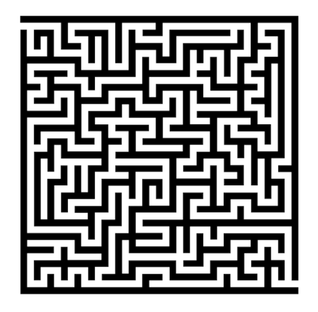
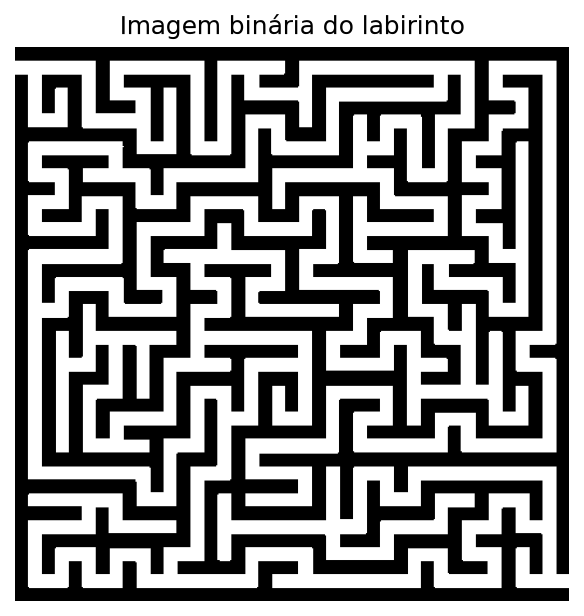
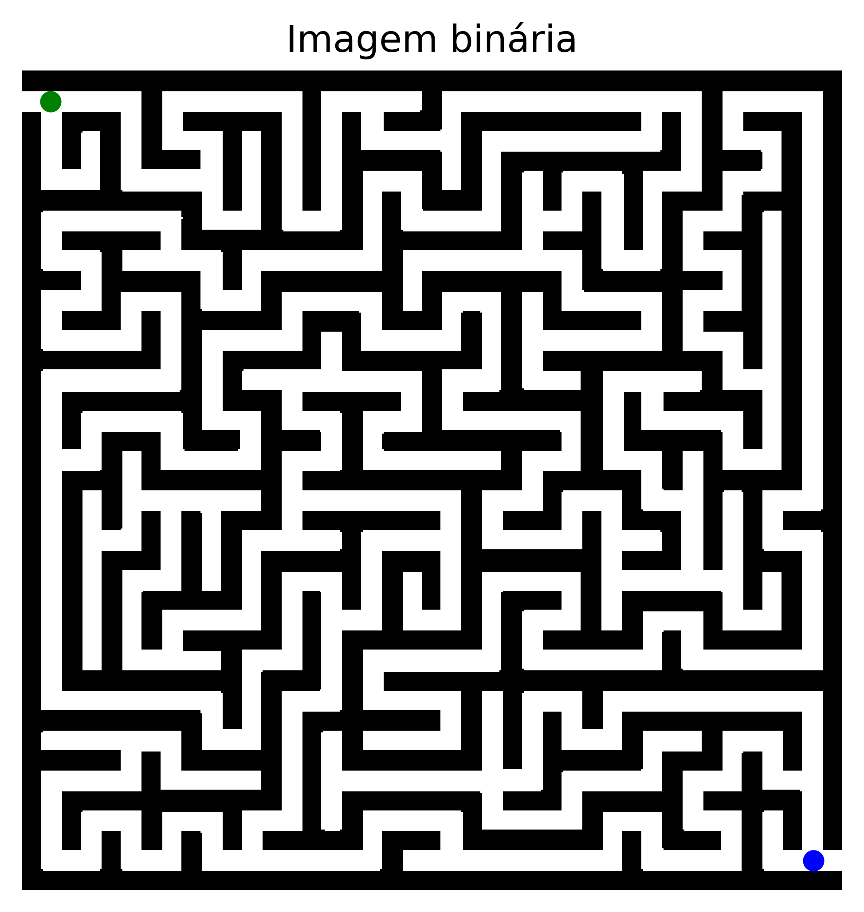
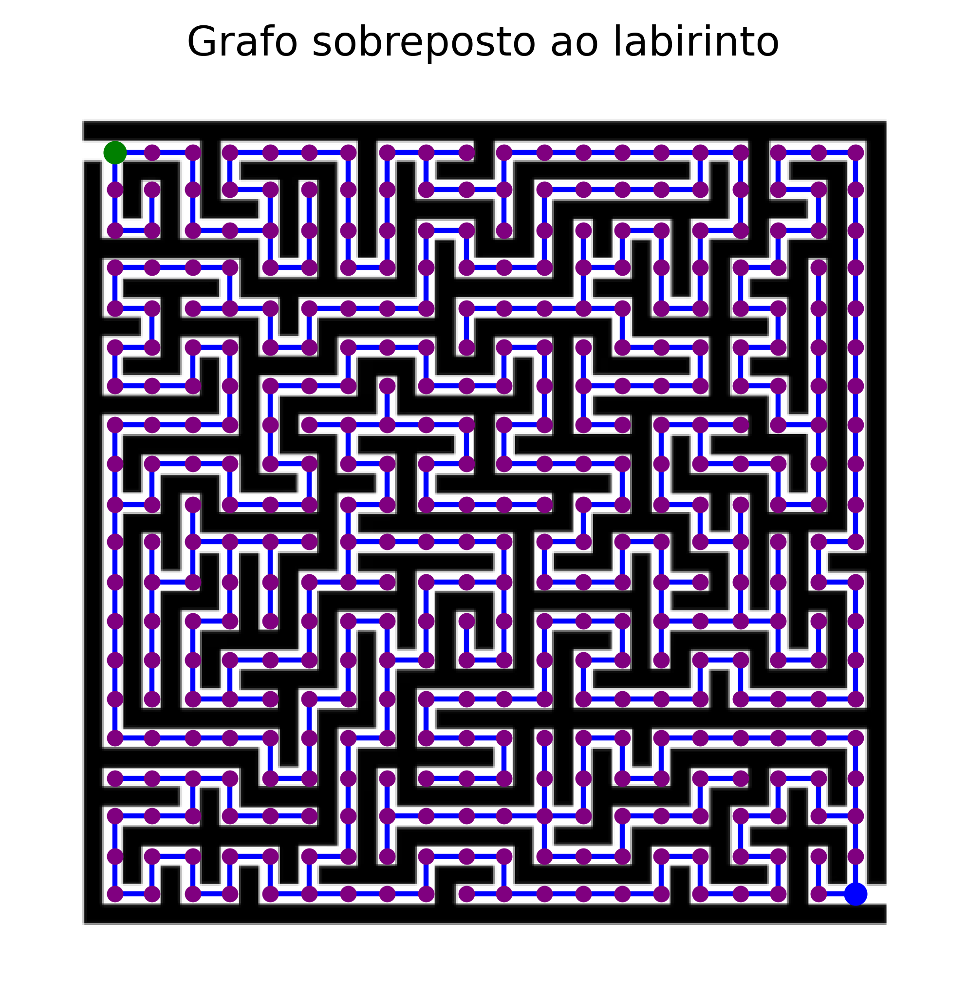
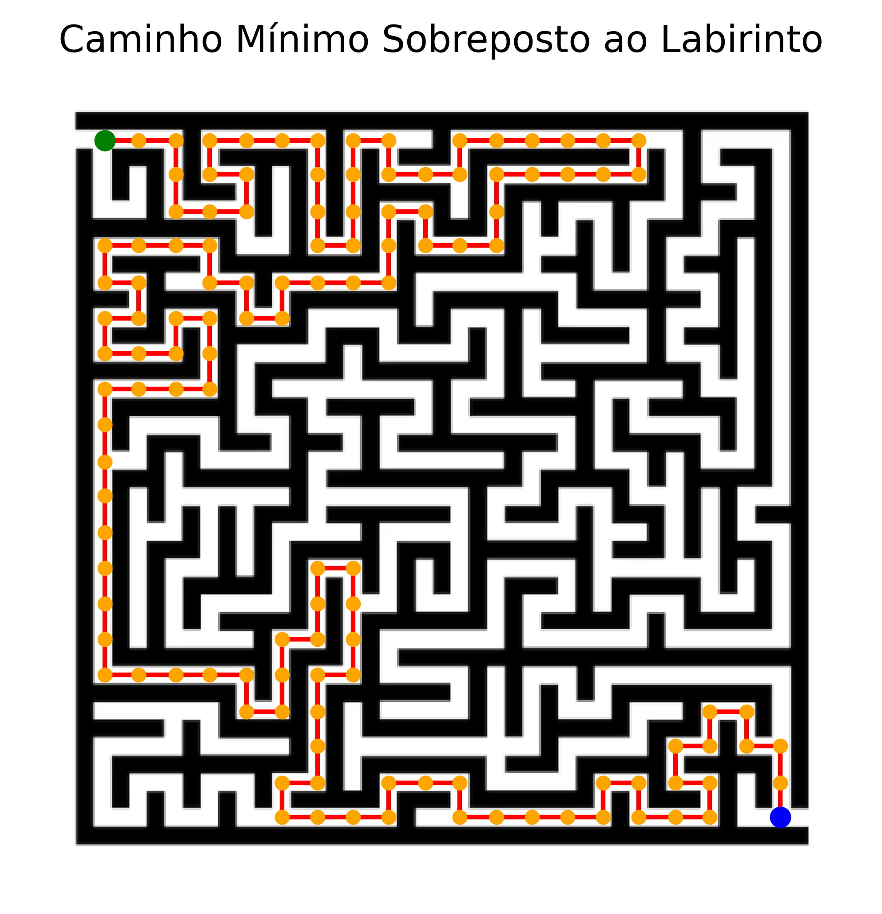
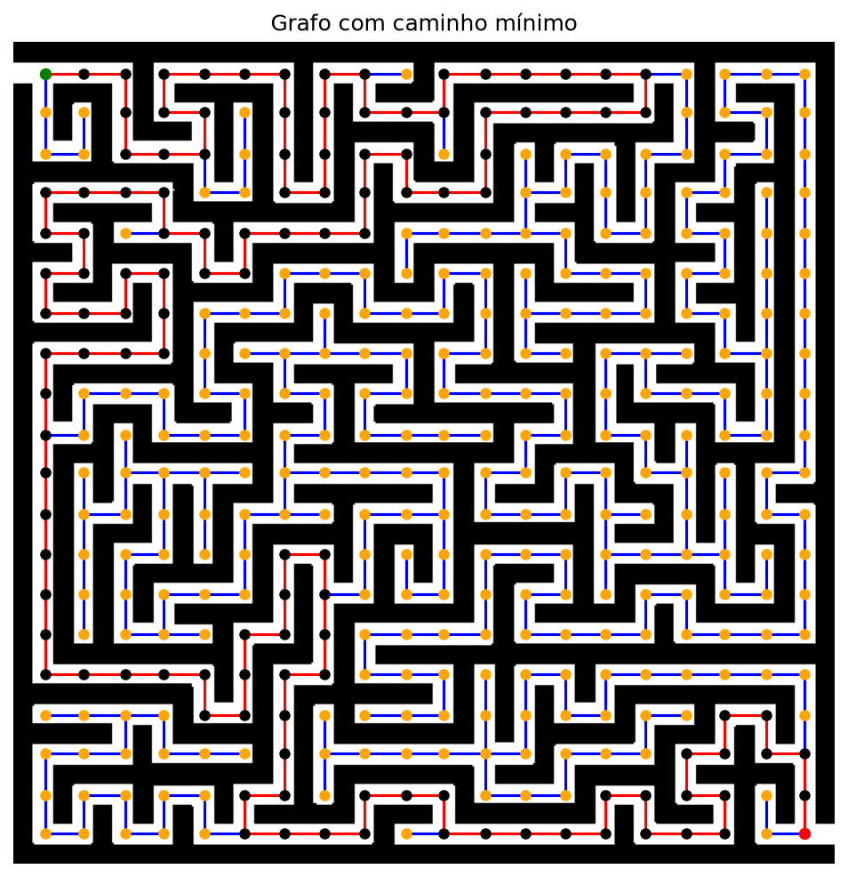

# RELATÓRIO - LISTA COMPUTACIONAL 2

**Período 2.2 - Otimização Linear**

André Felipe Oliveira, Davi Pestana, Felipe Ribeiro, Gabriel Krauss

**IMPA Tech**

> Versão em PDF deste relatório: [RELATORIO.pdf]([RELATORIO.pdf](https://github.com/GabrielKrauss2025/Shortest_Path/blob/main/RELAT%C3%93RIO%20-%20LISTA%20COMPUTACIONAL%202.pdf))

## 1. Introdução

O objetivo dessa atividade é transformar a imagem de um labirinto em uma estrutura de grafo, com o intuito de resolver o problema de caminho mínimo entre a entrada e a saída. Com essa modelagem reduzimos o problema a apenas aplicar um algoritmo conhecido para esse problema em grafos, como o algoritmo de Dijkstra. Todo o código foi implementado em Python.

Em nosso problema são permitidos apenas movimentos cardeais, sendo os movimentos diagonais desconsiderados. No nosso problema todas as arestas possuem peso 1, com isso, o custo de cada caminho é apenas o seu deslocamento.

<p align="center">
  
</p>

<p align="center"><em>Figura 1 - Labirinto original</em></p>

## 2. Tratamento da imagem

### 2.1. Criando a imagem binária

Inicialmente, carregamos a imagem e convertemos para a escala de cinza para que cada pixel passe a ter um único valor de intensidade, após isso transformamos o resultado do processo em uma matriz, usando um valor de corte para binarizá-la. Com isso, binarizamos o labirinto sob a seguinte regra:

$$
B(i,j) =
\begin{cases}
1, & \text{se o pixel pertence a uma região livre,} \\
0, & \text{se o pixel pertence a uma parede.}
\end{cases}
$$

Assim, o valor 0 na matriz binária representa uma parede (pixel preto) e o valor 1 representa uma região livre (pixel branco). Em seguida, recortamos a matriz na menor caixa que contém todas as paredes, removendo a margem branca ao redor do labirinto, e guardamos o deslocamento desse recorte para poder desenhar depois sobre a imagem original. A imagem binária obtida é mostrada na Figura 2.

<p align="center">
  
</p>

<p align="center"><em>Figura 2 - Imagem binária do labirinto recortada</em></p>

Identificamos a entrada e saída do grafo tomando o ponto médio da abertura formada pelos pixels 1 da primeira e da última coluna, respectivamente, com uma tolerância para os pontos estarem dentro do labirinto.

<p align="center">
  
</p>

<p align="center"><em>Figura 3 - Labirinto com pontos de entrada e saída</em></p>

### 2.2. Criando as células e construção das arestas

Após isso, criamos uma grade de células, nomeando-as segundo o identificador indicado na atividade, sendo ele:

$$
\mathrm{id}(i,j) = (i-1)\,n + j,
$$

A partir disso, construímos as arestas analisando o ponto médio entre as coordenadas do centro de duas células vizinhas. Caso o pixel resultante seja 1 é uma região livre, então ligamos as duas com uma aresta, caso contrário o pixel é 0 então é uma parede não sendo feita uma aresta. As células são verificadas por pares: horizontalmente vizinhas $(i, j)$ e $(i, j+1)$, e verticalmente vizinhas $(i, j)$ e $(i+1, j)$. Criamos o grafo com o identificador das células como vértices e o conjunto de arestas que obtemos ao verificar as células vizinhas.

Finalizamos com um total de 400 vértices e 399 arestas no grafo final.

<p align="center">
  
</p>

<p align="center"><em>Figura 4 - Labirinto com grafo completo sobreposto</em></p>

Sobrepondo o grafo à imagem original, verificamos visualmente que todos os vértices ficam no centro de células livres e que nenhuma aresta atravessa uma parede.

## 3. Formulação como problema de caminho mínimo

Seja $G = (V, E)$ o grafo construído, com $V$ o conjunto das 400 células e $E$ o conjunto das passagens livres entre células vizinhas. O vértice inicial é $s = 1$, que corresponde à entrada (célula $(1,1)$, canto superior esquerdo), e o vértice final é $t = 400$, que corresponde à saída (célula $(20,20)$, canto inferior direito).

O labirinto pode ser interpretado como um problema de caminho mínimo porque cada passagem livre entre duas células é uma aresta e cada parede é a ausência de aresta. Assim, um percurso válido da entrada à saída é exatamente um caminho $P = (s, v_1, v_2, \dots, v_k, t)$ em $G$, e o melhor percurso é aquele que minimiza

$$
C(P) = \sum_{e \in P} c_e.
$$

Como $c_e = 1$ para toda aresta, o custo de um caminho é $C(P) = |P| - 1$, em que $|P|$ é o número de vértices do caminho. Ou seja, o custo é o número de movimentos realizados, e minimizá-lo equivale a encontrar o caminho com o menor número de movimentos.

## 4. Funcionamento do Dijkstra

O algoritmo de Dijkstra calcula as distâncias mínimas a partir de um vértice inicial em um grafo com pesos não negativos, sendo aplicável no nosso caso, tendo em vista que todas as arestas possuem peso 1.

Iniciamos o algoritmo definindo o vértice inicial, sendo no caso o vértice 1. Sua distância é definida como zero e as distâncias dos demais vértices como infinito. Além disso, também inicializamos o dicionário **anterior**, que será usado para guardar o pai de cada vértice.

Adicionamos o vértice inicial a um heap-min auxiliar D, sendo a distância o parâmetro para ordenação. Enquanto D tiver elementos fazemos as seguintes ações:

- Pegamos a distância e o vértice de maior prioridade.
- Verificamos se a distância provisória é maior que a distância atual, caso seja não olhamos para seus vizinhos, do contrário, seguimos.
- Para cada vizinho do vértice atual, caso a distância provisória + 1 seja menor que a atual distância para aquele vizinho atualizaremos a distância e adicionaremos o vértice atual como pai do vértice vizinho.
- Por fim, caso a distância tenha sido atualizada, adicionamos o vizinho ao heap-min auxiliar D.

A execução termina quando não há mais vértices alcançáveis, isto é, quando o heap-min auxiliar D for vazio, retornando as distâncias de cada vértice e o pai de cada um deles.

Implementamos o algoritmo na função `dijkstra(A, s)`, em que `A` é o grafo, representado como um dicionário de listas de adjacência, e o heap-min é feito com a biblioteca `heapq`. A função retorna **dist** e **anterior**. A complexidade é $O((|V| + |E|) \log |V|)$.

## 5. O caminho mínimo

Tendo em vista que o Dijkstra retorna a distância e o pai de cada vértice, reconstruímos o caminho mínimo partindo do vértice final até o inicial pelos pais de cada um deles, sendo analisados sucessivamente. Assim, basta inverter a lista obtida e conseguimos listar todos os vértices que estão contidos no caminho mínimo em ordem, além de ao tomar dois vértices consecutivos obtermos as arestas que compõem o caminho.

Observe na Figura 5 o caminho mínimo encontrado pelo algoritmo de Dijkstra.

<p align="center">
  
</p>

<p align="center"><em>Figura 5 - Labirinto com caminho mínimo sobreposto</em></p>

## 6. Análise dos resultados

Ao representarmos o labirinto por um grafo possibilitamos um estudo formal da conectividade e do cálculo de rotas. A análise visual do grafo sobre a imagem original também é importante principalmente para verificar a corretude das funções, avaliando se porventura alguma aresta foi construída de maneira indevida.

Com isso, avaliamos experimentalmente a eficiência da modelagem do labirinto como um grafo, tendo sido determinado pelo algoritmo o menor caminho composto por 123 vértices e 122 arestas em um tempo de execução de apenas 0,0001725 segundos. Como todas as arestas possuem peso 1, temos que o tamanho do caminho é o custo dele, totalizando um custo de 122 passos.

A relação entre as arestas e os vértices nos mostra uma trajetória simples e sem ciclos, além do tempo em microsegundos evidenciar que a abstração da imagem para uma estrutura discreta reduziu significativamente o custo computacional do problema.

<p align="center">
  
</p>

<p align="center"><em>Figura 6 - Labirinto com caminho mínimo no grafo completo sobreposto</em></p>

## Como executar

Pré-requisito: Python 3 (testado com Python 3.13).

```bash
python -m venv .venv

# Windows (PowerShell)
.venv\Scripts\Activate.ps1
# Mac / Linux
source .venv/bin/activate

pip install -r requirements.txt
python shortest_path/main.py
```

O `main.py` executa as partes 1, 2, 3, 6 e 7 na ordem, imprime os resultados no terminal e salva as figuras em `img/`. Cada figura abre em uma janela do Matplotlib, e o programa só continua quando a janela é fechada. A Parte 4 é teórica e está neste relatório, e a Parte 5 (Dijkstra) está em `shortest_path/parte_5.py`.
